# cloud-previews — 各 worktree の雲の見た目を自分の目で見る

編集中の worktree ごとに、雲がどう見えるかを確かめるための手順と、撮影済みの画像をまとめた。
画像は `shots/<worktree名>/` 以下。`npm run cloud-lab:shot` で撮った PNG(全球の量の図 × 時刻 0h/25h)
のうち、雲の見た目が分かる代表的なものを抜粋してある。撮影した時点のソースの見た目であり、
worktree 側の作業が進めば古くなる。

## このフォルダから一発で見に行くコマンド

このフォルダ(`memos/mikanixonable/cloud-previews/`)の位置から、次の形でそのまま実行できる。
ポートは固定(本体 8080・雲ラボ 8083)なので、同じものを同時に 2 つは上げられない — 1 つずつ見る。
worktree に `node_modules` が無い場合は先に `cd` して `npm ci`。

```bash
# 基準: devin/dev 本体
cd /Users/pandeaconica/lab/dive-into-tepui2 && npm run cloud-lab          # http://localhost:8083
cd /Users/pandeaconica/lab/dive-into-tepui2 && npm run dev                # http://localhost:8080(ゲーム本体)

# gen-dynamics(気象力学 — pressure/surfaceWind/lift ビューが効く)
cd /Users/pandeaconica/lab/dive-into-tepui2/.claude/worktrees/gen-dynamics && npm run cloud-lab

# motion-stage2(雲の動き — 時刻を動かして変化を見る)
cd /Users/pandeaconica/lab/dive-into-tepui2/.claude/worktrees/motion-stage2 && npm run cloud-lab

# cloud-cells(積雲の細胞 — cumulus/coverage/composite の粒だち)
cd /Users/pandeaconica/lab/dive-into-tepui2/.claude/worktrees/cloud-cells && npm run cloud-lab

# cloud-optics(光学 — 雲ラボの図には出にくい。ゲーム本体で見る)
cd /Users/pandeaconica/lab/dive-into-tepui2/.claude/worktrees/cloud-optics && npm run dev

# translucent-teacher(半透明雲 — cirrus/translucent ビュー)
cd /Users/pandeaconica/lab/dive-into-tepui2/.claude/worktrees/translucent-teacher && npm run cloud-lab

# sunset-refine(夕景 — ゲーム本体で夕刻条件にして見る)
cd /Users/pandeaconica/lab/dive-into-tepui2/.claude/worktrees/sunset-refine && npm run dev

# cirrus-types(tools のみ・見た目の変化なし)
cd /Users/pandeaconica/lab/dive-into-tepui2/.claude/worktrees/cirrus-types && npm run cloud-lab
```

### 教師(実写)と見比べる

- 雲ラボの `photo` ビューが、同じ図法(正距円筒)で写した**実写**。生成ビューと切り替えて見比べられる。
- 実写を区分ごとに集めた目録は `.cloud-detail/reference/`(実写の参照画像群)。
- 生成と実写の統計比較を回す場合(数分〜):

```bash
cd <worktree> && npm run cloud-lab:compare      # .cloud-lab/compare/ へ
cd <worktree> && CLOUD_DETAIL_PORT=8813 CLOUD_DETAIL_DEBUG_PORT=9513 \
  npm run cloud-detail:compare                    # 型・区分ごとの距離(重い)
```

## 撮影済みの画像(shots/)

### dev — メイン worktree(devin/dev、比較用)

基準となる現在の雲。

- 
- 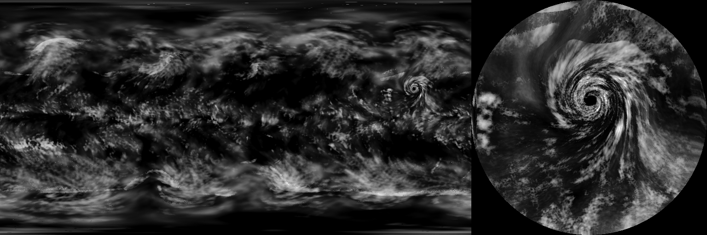
- 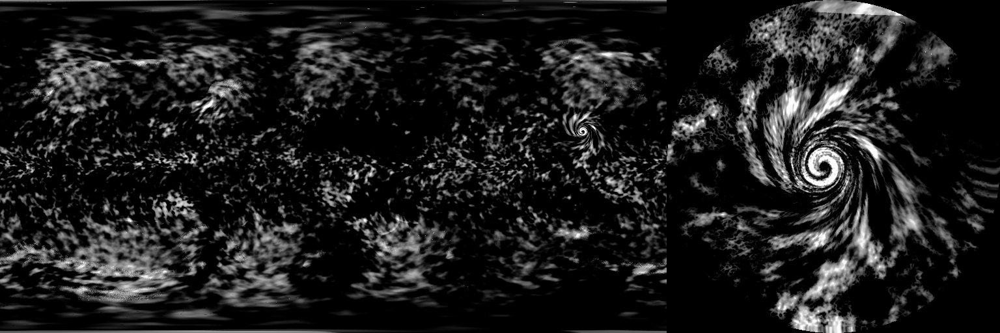
- 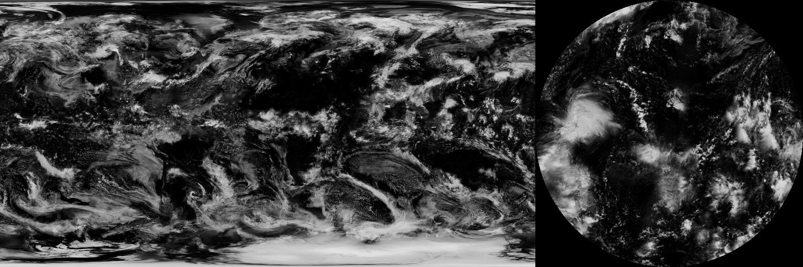 — 教師(実写)との見比べ用

### gen-dynamics — 気象力学ループ

気圧配置・風・上昇流を実写分布へ近づける途中。雲の配置の多様性に効く。

- 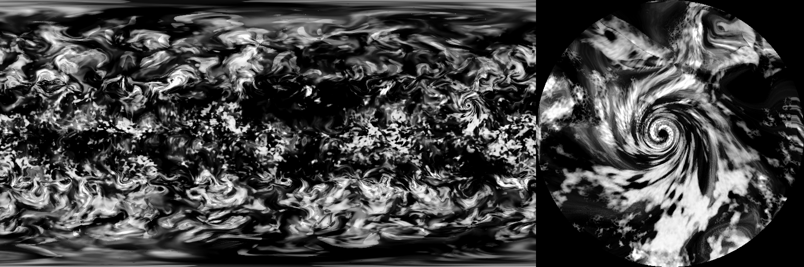 / 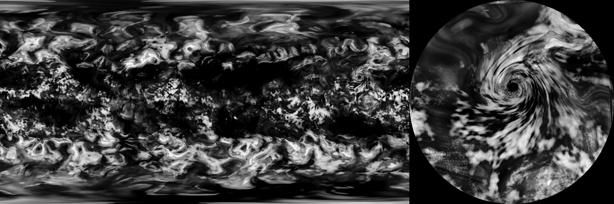
- 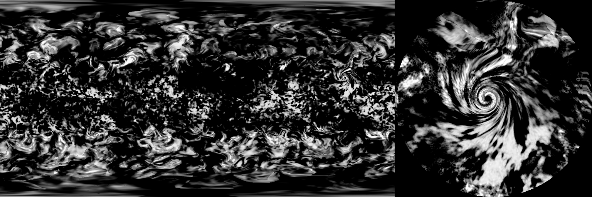
- 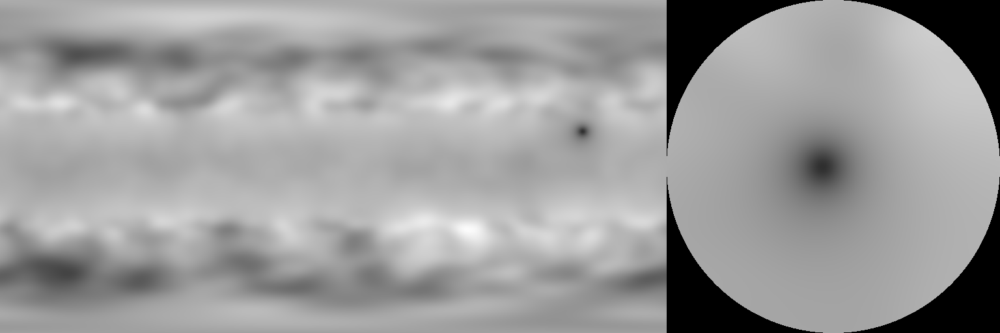 — 気圧場の多様性が直接見える

### motion-stage2 — 雲の動き・輸送

雲の動き・輸送の改善途中。0h と 25h の差に効くはず。

- 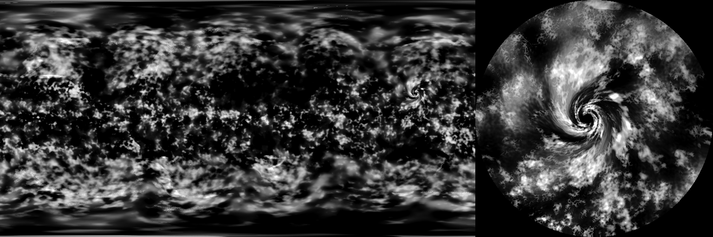 / 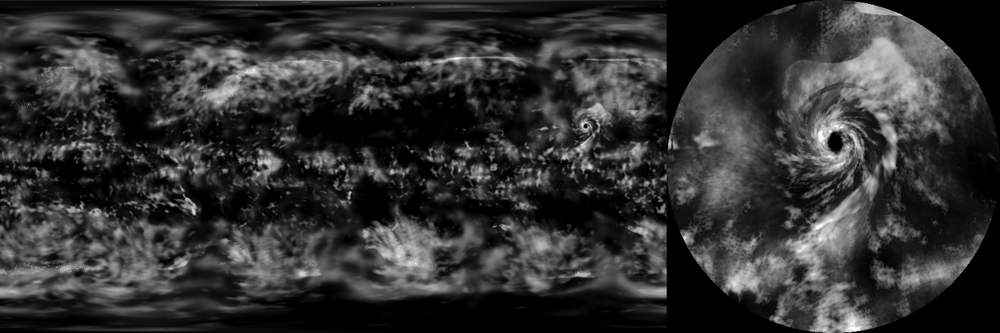
- 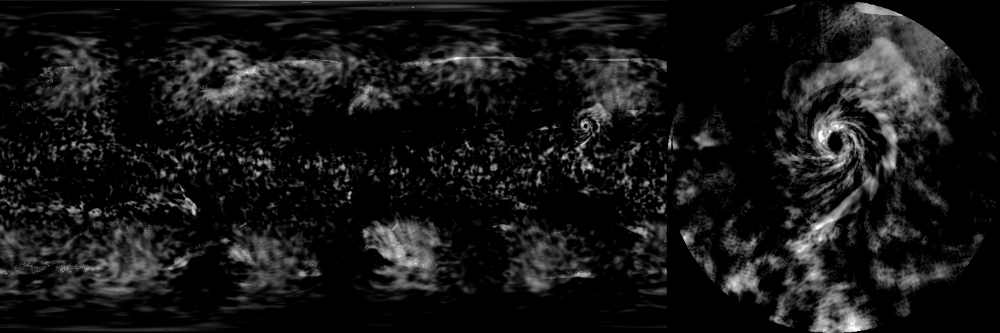

### cloud-cells — 積雲の細胞構造

積雲の細胞・中規模構造の改善途中。`cumulus`/`coverage`/`composite` の粒だちに効くはず。

- 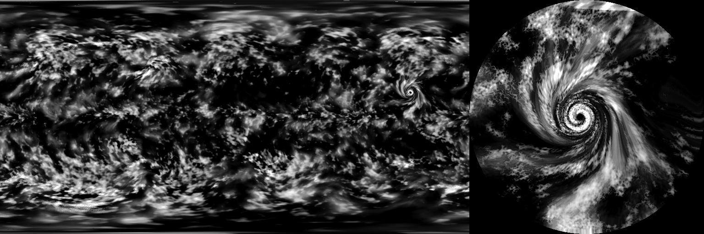
- 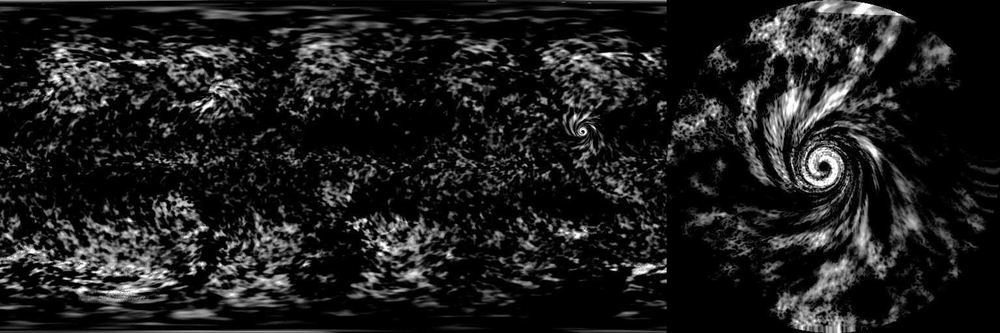
- 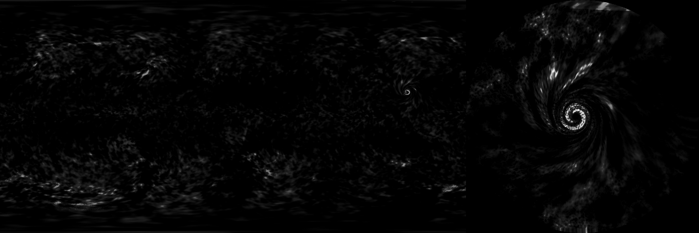

### cirrus-types — 巻雲教師の拡張

tools のみの変更で見た目の変化は無いはずなので撮影は省略。

### cloud-optics — 雲の光学

雲の光学(明るさ・影)の物理化。雲ラボの量の図には出にくい — ゲーム本体で見るのが本筋。

-  / 

### translucent-teacher — 半透明雲教師

半透明雲教師の拡張途中。`translucent`/`cirrus` ビューに効くはず。

- 
- 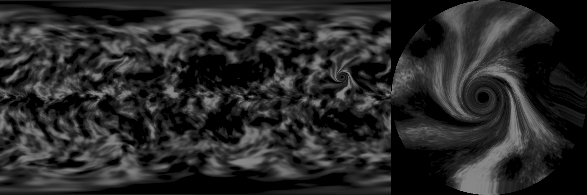
- 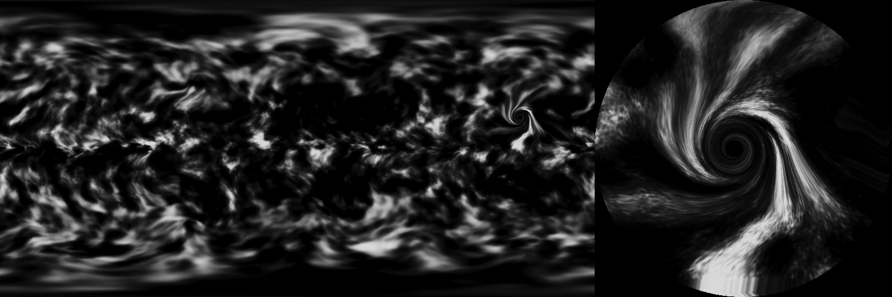

### sunset-refine — 夕景の分光・消衰

夕景の分光・消衰途中。描画側なので雲ラボの図には出にくい — ゲーム本体で夕刻条件にして見るのが本筋。

- 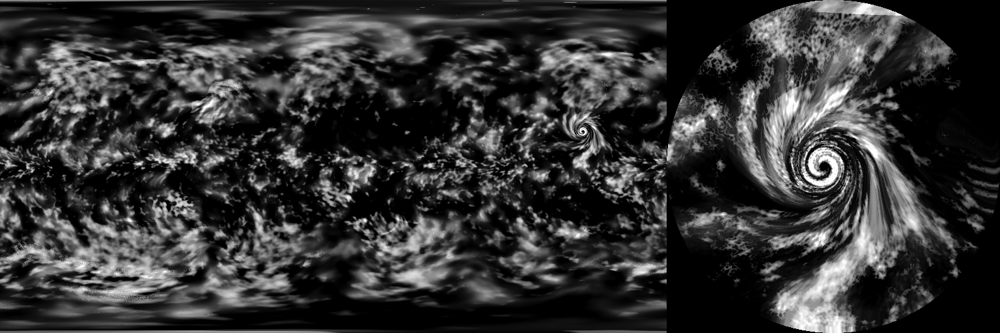 / 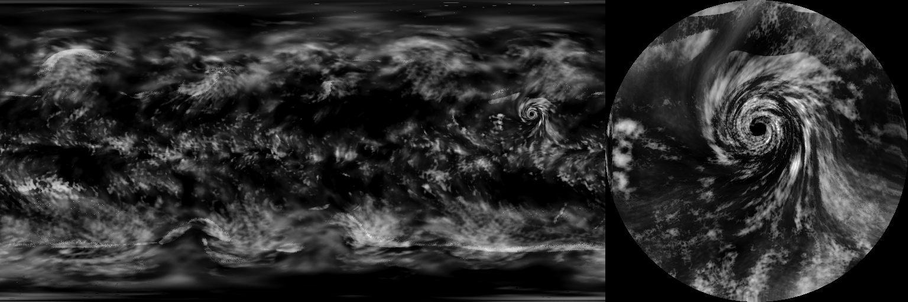
