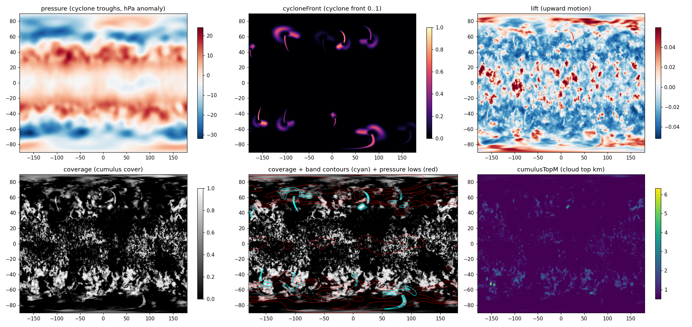

# 低気圧と前線の位置 — t=180h(生成気象 probe h0180 と同じ時刻)

`lowPlacementAt` / `tropicalPlacementAt`(src/render/cloud/cyclone-tracks.ts)から
直接計算した配置。t=180h で活動中の中緯度低気圧は 5 個(熱帯低気圧なし)。

| id | 緯度° | 経度° | 深さ hPa | 短軸半径 km | life |
|----|------|------|---------|-----------|------|
| L2 | +44.5 | -175.3 | 11.9 | 671 | 0.14(波動期) |
| L3 | -50.3 | -156.7 | 17.3 | 1016 | 0.42(最盛期) |
| L4 | +64.0 | -98.7 | 14.0 | 1277 | 0.79(成熟期) |
| L5 | -53.8 | -101.1 | 9.0 | 1140 | 0.79(成熟期) |
| L6 | +59.2 | -16.7 | 2.5 | 1165 | 0.96(消衰) |

線は `Trough.frontAt` の腕の芯の曲線(強さでなく位置):

- **青 = 寒冷前線** — φ(ρ) = −115° + 0.3·(ρ/半径) の極曲線。赤道側へ
  ~2.2 半径分伸び、先端が渦向きへ巻く。先行(暖域)側の縁が鋭い
- **赤 = 温暖前線** — φ = 40° − narrow(life)。下流・極側へ 1.4 半径分。
  極側へ非対称に広い層状の盾(実装の非対称幅 1.8 倍)
- **緑破線 = 巻き(オクルージョン/コンマ頭)** — 極側〜西を渦向きに巻く弧。
  life 0.3-0.6 で立ち上がるので若い低気圧(L2)ではまだ出ない
- **赤× = 低気圧中心**、紫○ = 熱帯低気圧(この時刻はなし)

半球の向き: 北半球では φ 増大 = 反時計回り(CCW)、南半球では時計回り(CW)
— 局所座標の「極方向」が半球で反転するので、同じ式で両半球の巻き向きが出る。
南の L3・L5 は北と鏡像の巻き方をしているのが図で読める。

再生成: `node` で tests/dist の cyclone-tracks を呼び、腕は cyclones.ts の
定数(COLD_BEARING 等)で極曲線として描画。気象の焼き出しと同じ時刻で
見比べるときは `python3 tools/cloud-regime-plot.py <時刻>` と併用する。
